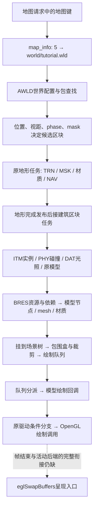

# Ghidra工程与原地图载入到绘制总览

2026-11-10，基线4abe9e9。目标是把原文件和原代码放进可重复打开、交叉跳转的分析工程，优先看整条地图路径。没有恢复网页、游戏服务器、地图画面或自写渲染器；自动任务2保持暂停。

## 工具与工程

已使用官方发布安装Ghidra 12.2、Temurin JDK 25.0.5+8，并按Ghidra随附说明在Apple Silicon上编译mac_arm_64原生组件。未修改系统Java或全局shell配置。

| 本地内容 | 位置 |
| --- | --- |
| Ghidra | `/Users/kevin/Applications/OC2Tools/ghidra_12.2_PUBLIC` |
| 专用JDK | `/Users/kevin/Applications/OC2Tools/jdk-25.0.5+8/Contents/Home` |
| 分析工程 | `analysis/raw/ghidra-projects/OC2_31320_ARM64.gpr`及同名`.rep`目录 |
| 导入的原程序 | `libOrderChaos2.so`，ARM64，镜像基址0 |
| 分析输出 | `analysis/raw/ghidra-20261110/` |
| 打开入口 | [tools/open_ghidra.command](../tools/open_ghidra.command)，可双击 |

原库38,892,376字节，SHA256为`77f449f2100a4717578e282bb04f1f8fff25d25c7bfa461d7d39ee49d1cb8ca4`，与APK的`lib/arm64-v8a/libOrderChaos2.so`一致。Ghidra里的`oc2r_`函数名和`OC2 Map-to-draw`书签是本项目的研究标记，不是找回的原C++符号。反编译C是工具对原指令的近似表达，不是原开发工程源码。

导入器先检查整库SHA、原异常展开表的函数起点及各函数字节摘要；Ghidra脚本再次核对工程中这些地址的实际字节后才加标记，不修改指令。无原始输入时不能重新生成这个工程。

首次全库自动分析用时702秒，未达到900秒上限；出现部分反编译/寄存器分析错误及外部库缺失，日志完整保留。Ghidra自动识别数与原展开表的92,876条入口不是一一对应，不能称为全库已正确分析。已按原边界校正一个被合并的收集函数，并为漏识别的重点入口建函数；相关调整记录在`first-export-report.json`和后续报告里。

本轮最终89/89个重点函数成功导出，重新打开同一工程复导出通过，报告中的原库SHA、语言`AARCH64:LE:64:v8A`和基址0一致。成功导出仍可能含间接调用、尾跳转和类型推断警告，不能把生成的C直接当作正确原源码。图形界面的启动日志确认同一工程打开；桌面工具未能识别该Java窗口，未宣称完成窗口点击或视觉验收。

## 先看整条路径

下图是静态研究导航。连线不表示原Android进程已成功运行到终点；地形、建筑、材质和帧绘制有各自状态、条件及失败分支。



| 阶段 | 原地址导航 | 已有依据与边界 |
| --- | --- | --- |
| 请求与世界 | `a34f28 → 539508 → 8fcb1c → 8fd1e4` | 一个请求路径生产分支、消费和AWLD读取已找到；网络消息到状态任务的完整调度未闭合，不称为直接逐次调用链。见[请求与区块](MAP_REQUEST_AND_STREAMING.md)。 |
| 决定区块 | `366ca0 → 367684 → 35200c → 3412a0` | 原中心转换、视距/缓存和任务入队；活动设备配置、动态写入和真实线程时序不能由离线输入代替。 |
| 地形读取 | `354ca0 → 354de4 → 358e08` | 原TRN/ATIL、遮罩和材质读取已有文件关联；完整地形GPU批次到绘制的链还需核对，不能用下方建筑mesh分支代替。 |
| 建筑读取 | `3673b0 → 367884 → a5f518 → a60a60` | 地形发布后接建筑任务；ITM、PHY、声音、条件光照、实例各有阶段。见[原始加载链](ORIGINAL_MAP_LOADING.md)。 |
| 模型与材质 | `a6196c → a63218 → 33ebf8`，`1181778/117ec68/148daa8/1180360`，`112330c/111dae0/111b8c4` | 12个研究实例关联六模型、七材质、三效果；原资源读取、重定位和装配已有证据。完整真实VFS返回、GPU编译及材质重绑没有执行。见[效果与材质](EFFECT_RESOURCE_AND_MATERIAL.md)。 |
| 场景与提交 | `1362f6c/1362320`，`12ba4d8 → 12f1378`；visitor `1324234/13246d8`；mesh提交`1132bc8`及队列`12f368c` | 父子挂接、矩阵/裁剪和队列提交分支可追；实际父节点/相机/活动材料仍未知。不是所有对象、所有分支都已恢复。 |
| 帧绘制 | `4dc648 → 34ed98`，场景虚调用到`12f5770/12f6b5c/12f4bac`等 | 必须与`53b2a0 → 34df7c`的更新路径分开。`34f154`涉及另一场景相关对象和相机运算，未武断命名为绘制pass。 |
| 队列到GPU | `12f6528 → virtual+10 → 113011c`，下节条件分支 | 新核对的一条32字节队列消费分支，不表示所有队列格式与pass均已闭合。`12f6310`是堆排序，不是绘制消费者。 |
| 呈现 | `14f1890 / 150039c → eglSwapBuffers` | 找到原库真实呈现调用点；尚未把本机不存在的原Android帧循环、活动surface/后端补成运行结果。 |

## 新核对：建筑绘制队列怎样到OpenGL

这里的箭头是有条件的原分支，不给未知参数填默认值。

1. `12f6528`消费32字节记录，`12f66b8`取节点`+0x120`控制器，`12f66c0/66c4`调用其虚表`+0x10`。普通mesh节点的原虚表`244e538+0x10`重定位到`113011c`。
2. `113011c`处理节点/部件及材质。其`113048c`普通分支调用`315d18`，再通过所传驱动的`virtual+0xa0`分派。原GLES虚表`2492cf0+0xa0 → 1477984`；该函数检查缓存、几何计数及标志，部分分支直接退出，另一分支转到`virtual+0x238`。不能省略这些条件说“节点提交就一定绘制”。
3. 节点`+0x164`非零的另一分支在`1130450`调用`1478180`；它也有原标志/计数守卫，通过时才转到驱动`virtual+0x238`。字段未完整命名，不把非零擅自称为某种原游戏效果。
4. 原GLES虚表`2492cf0+0x238 → 1424474`。此函数按原条件调用`143ab50`或`143ad38`；前者实际调用导入的`glDrawElements/glDrawArrays`，后者及`143ae7c`调用对应Instanced入口。原驱动另外的`+0x208/+0x240`槽和另一后端`14a7eb8`也已定位，但不代选当前后端。
5. `113011c`末尾另有条件调用mesh资源`virtual+0xb0`。**原静态mesh虚表`244e410+0xb0 → 1197014`只有`ret`，是空操作。** 因此不能沿这个槽伪造“mesh→GPU”的主链；真正的条件绘制在上面的驱动路径。

原文件的重定位和固定位置指令由[ghidra_map_project.py](../tools/ghidra_map_project.py)重新读取、逐项断言，输出`draw-evidence.json`。API目标还通过原ELF的`.rela.plt/.dynsym`解析，不只凭名字搜索命中。没有执行这些GPU调用，没有提供成功返回值，也没有渲染帧。

## 工具怎样选

- [Ghidra](https://github.com/NationalSecurityAgency/ghidra)：当前优先，用于原生so的反编译、交叉引用、虚表和整条路径导航。
- [JADX](https://github.com/skylot/jadx)：适合查APK的Java启动、下载/目录处理及JNI入口；不能替代这个游戏so内部的C++分析。当前没有额外安装。
- [GhidraMCP](https://github.com/LaurieWired/GhidraMCP)：把反编译、函数/引用查询等Ghidra能力接给AI工具，可以减少手工导出。它是桥接插件，不是另一套地图恢复器；本次查看的README安装前提为12.1.4，与本机12.2的兼容尚未验证，本轮未安装或配置。
- [Frida](https://github.com/frida/frida)：观察原程序运行时调用与数据，适合验证“原版实际走了哪个分支”。需要原进程和对应设备连接；不能用本机静态分析代替这个运行条件。
- [O&C BDAE Viewer](https://github.com/fata1error404/oac-bdae-viewer)：格式研究参考。其一代游戏BDAE版本779与当前样本946不同，不能直接称为支持本项目或一键还原地图。

Ghidra官方[入门及原生组件编译说明](https://github.com/NationalSecurityAgency/ghidra/blob/master/GhidraDocs/GettingStarted.md)、[headless说明](https://github.com/NationalSecurityAgency/ghidra/blob/master/Ghidra/RuntimeScripts/support/analyzeHeadlessREADME.md)，JDK使用[Adoptium官方归档安装方式](https://adoptium.net/installation/archives/)。实际安装档及API元数据留在本地输出的`downloads/`，两个安装档SHA分别为：

```text
Ghidra: 2c2cd776db3c1f6a097ba418922378ac3649cadd5e844a6f5f088ae628a7be67
JDK:    36dc14d797aaff6d89aab302cd053fdba6207dfdcf772052fa7b023a94b0e857
```

## 重开和复核

先关闭同一工程的GUI，再执行headless；不能让两者同时写数据库。

```sh
# 只核对原字节、研究入口和绘制分支，生成本地manifest
.venv/bin/python tools/ghidra_map_project.py prepare
# 首次导入；若工程已存在会拒绝覆盖
.venv/bin/python tools/ghidra_map_project.py import
# 保留现有工程分析，重新校验、加标记和导出
.venv/bin/python tools/ghidra_map_project.py export
# 打开已有工程
tools/open_ghidra.command
```

在工程窗口双击`libOrderChaos2.so`进入CodeBrowser，可用`G`输入上表原地址，或从Bookmarks找到`OC2 Map-to-draw`研究书签。

`--ghidra/--jdk`可指定其他安装位置；GUI启动器对应`OC2_GHIDRA_ROOT/OC2_JDK_ROOT`。脚本默认路径针对这次本机安装，未声称是通用安装器。全量分析设置900秒上限，函数导出逐个45秒上限；超时/失败必须读日志和报告，不能以工具启动成功当作反编译成功。

## 仍缺什么

- 原Android进程的活动配置、实际VFS/材质编译结果、驱动和帧循环尚未观测；原库缺外部Android系统库及可用DWARF调试资料。
- 建筑模型已有上述条件链；**地形所有GPU批次、水面、全部pass/排序、HDR与最终呈现的完整衔接仍未闭合**。不能以找到`glDrawElements`就宣布新手地图1:1完成。
- 这12个实例最终显示哪些、怎样受光，仍取决于原活动配置/相机/父变换/材质和资源成功状态。Ghidra项目方便继续追查，不生成这些状态。

后续先沿同一工程补地形任务到绘制队列、核对帧入口的场景分支和最终呈现关系；不新写游戏、接口、光照配置或美术补缺。完整反汇编、反编译C、原库、Ghidra数据库及私有存档留在忽略目录。

## 核查与交接

原虚表六槽、14处关键原指令及15处绘制/呈现API调用检查通过；现有区块加载4项、场景绘制7项检查通过，无失败或跳过。Python语法、启动器shell语法及Git空白检查通过。41份原包共795,313,283字节与审计清单一致，私有角色存档与停止原型前备份逐字节相同；未恢复原型或转换预览目录。

关闭工程状态下已制作本地独立备份`backups/ghidra-map-flow-20261110-044059.zip`：159文件、224,507,307字节，ZIP CRC检查通过，内部`SHA256SUMS.json`列逐文件摘要，外部SHA256为`60c3a82c2710321a6af26fe59f18be5a368324924bce6a6c5b303e533e6cf41b`。包内包含原库、工程及原始研究输出，只留本地忽略目录；安装档不重复打包，指纹另存。安装与原生构建日志、本轮检查日志和`local-bundle.json`同样留本地。
