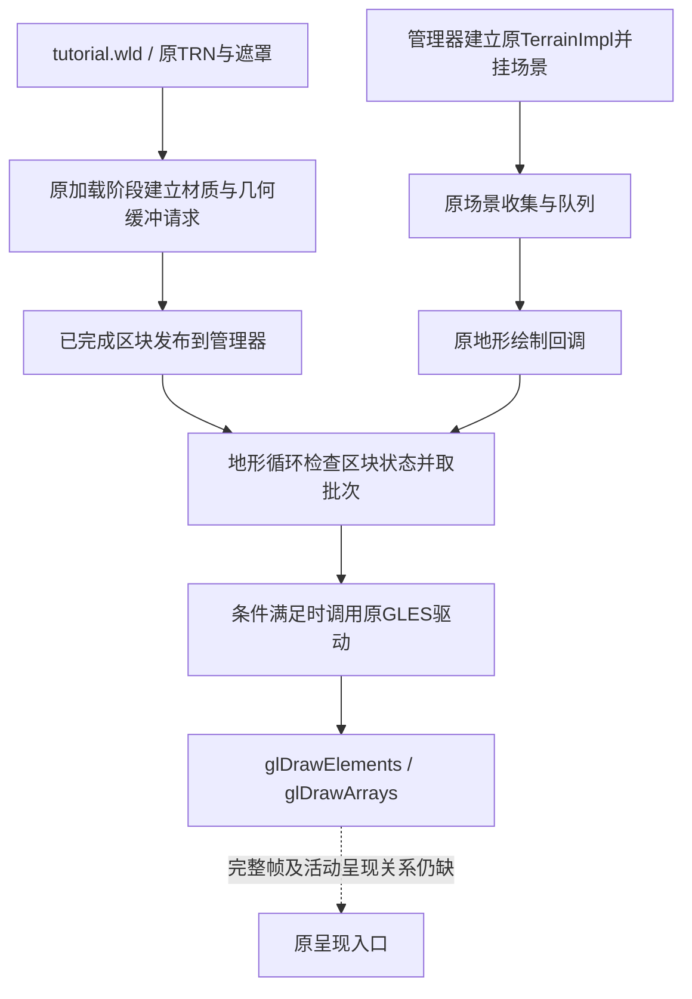

# GhidraMCP接入与新手地形绘制链

2026-11-10，基线fbb6024。GhidraMCP已针对本机Ghidra 12.2构建并通过实际读取测试。新增证据把原地形加载、专用场景对象、队列分派与一个GLES绘制分支接起来；没有创建游戏、渲染器或替代运行状态。地图画面仍未恢复，自动任务2保持暂停。

## 安装及兼容核对

| 内容 | 本轮结果 |
| --- | --- |
| 上游 | [LaurieWired/GhidraMCP](https://github.com/LaurieWired/GhidraMCP)，固定提交`1e980252087b2479a21b9ca6d82d5829538651a7`，包版本2.0.0 |
| 安装位置 | `/Users/kevin/Applications/OC2Tools/GhidraMCP`；独立Python环境为同目录下`ghidra-mcp-venv` |
| 编译 | 使用本机Ghidra 12.2、JDK 25.0.5+8及官方Gradle wrapper，11秒构建成功；没有修改上游源码 |
| 扩展 | 生成`ghidra_12.2_PUBLIC_20261110_GhidraMCP.zip`和`extension/build/libs/GhidraMCP.jar`，无界面模式显式加载该JAR |
| Python | Python 3.12；使用Ghidra随附PyGhidra 3.2.0、MCP SDK 1.30.0；完整依赖版本留本地 |
| 后端自报 | `version=2.0.0`、`ghidra_version=12.2`、`mode=headless`；与实际安装一致。握手里的1.30.0是SDK版本，不是GhidraMCP包版本 |
| 连接 | `http://127.0.0.1:8766/mcp`，仅本机；无外部托管或游戏服务器 |
| Codex | 已保存`mcp_servers.oc2_ghidra`，开启14种读取工具；其他配置逐项比较保持，原配置备份单独留在私有目录 |

上游README仍以12.1.4为安装前提，因此这里只声明**本机针对12.2重新编译及本轮读取功能实测通过**，不声称上游保证所有12.2功能兼容。实际测试包括MCP握手/工具清单、程序身份、函数查找/清单、反编译、反汇编、调用/引用关系与原内存读取；没有测试全部28种工具或全部修改操作。

Codex配置依据[官方MCP文档](https://learn.chatgpt.com/docs/extend/mcp?surface=cli)。本聊天使用MCP协议客户端实际查询同一服务，不把配置写入等同当前聊天的原生工具目录已经热重载。当前工作可以继续，不要求重启应用。

## 工程来源与打开方式

原GUI工程保持不动。从前轮已关闭并校验的备份提取9个工程文件，逐文件SHA核对，建立独立研究副本：

```text
analysis/raw/ghidra-mcp-projects/OC2_31320_ARM64.gpr
analysis/raw/ghidra-mcp-projects/OC2_31320_ARM64.rep/
```

同一原库SHA256仍为`77f449f2100a4717578e282bb04f1f8fff25d25c7bfa461d7d39ee49d1cb8ca4`，ARM64、基址0。新增入口按原异常展开表建立函数边界，指令字节再次核对；`oc2r_`仍是研究标记，不是原C++符号。

MCP独占这个副本时不要同时用GUI打开它。原GUI工程是独立快照，不会自动获得副本的新书签。服务没有设置开机自启、定时研究或自动续跑。手动启动：

```sh
tools/start_ghidra_mcp.command
```

本轮使用的[查询工具](../tools/ghidra_mcp_query.py)每次先确认原程序SHA、架构及基址，只允许读取，完整回应只能写入忽略目录。例如：

```sh
/Users/kevin/Applications/OC2Tools/ghidra-mcp-venv/bin/python \
  tools/ghidra_mcp_query.py get_function_calls \
  --args '{"address":"0x354ca0","direction":"callees","limit":100}' \
  --output analysis/raw/ghidra-mcp-20261110/terrain-task-calls.json
```

## 原地形怎样到绘制入口



场景对象建立和区块任务是两条相接的链，不是等全部地图文件读完后才创建场景。下列是静态原分支，没有给未知状态填默认值。

| 步骤 | 原代码/原文件 | 确认内容 |
| --- | --- | --- |
| 地图与输入 | `map_info`的5→`world/tutorial.wld`；AWLD配置`3,3,1`；`world/tutorial/terrain/-043_0002.trn` | 沿用[原加载证据](ORIGINAL_MAP_LOADING.md)和[区块调度](MAP_REQUEST_AND_STREAMING.md)。坐标只是研究样本，不是原出生点或现场加载中心 |
| 加载阶段 | `354ca0`的状态0..9；`3563dc`材质绑定；`3577ec`缓冲构造 | TRN、遮罩、光照、材质/分组、水面、导航和几何请求分阶段处理。状态推进/结束字节不能当GPU成功证明 |
| 几何输入 | `357938 → 1462ff8`，`357950 → 14509dc` | 原任务把CPU顶点流及原格式交给缓冲接口；显式tutorial配置对应65×65顶点、44字节步长，185900字节。没有执行或伪造缓冲返回；索引和邻接另有原构造路径 |
| 专用场景 | `35b32c → 35bb64`，原字串`TerrainImpl`，主虚表`240e800` | 管理器创建此对象，保存管理器指针到节点`+168`，按原父引用挂接。另创建`TerrainWaterImpl`；`ShadowImpl`还有原配置条件，不代选活动配置 |
| 场景提交 | 原基类链`12bfc28 → 1342f50`；`375294 → virtual+268 → 3752a0` | 基类把`node+120`默认设为自身。提交要求`(node+130 & 0x18)==0x18`，以code4、原priority参数送入上下文队列。后续控制器覆盖及活动标志未观测 |
| 队列消费 | `12f368c`的code4；`12f5770 → 12f6528` | code4按节点`+138`分到场景`+130`或`+1a8`的32字节队列；原消费者还含清队列/阶段条件，不能说提交后必画。分派通过`node+120`的virtual+10 |
| 地形回调 | `240e800+10 → 375354 → virtual+270 → 375360 → 35cfb4` | 这是原地形回调，区别于前轮建筑mesh回调。它从节点取原管理器和原驱动，进入地形循环 |
| 区块到驱动 | `35cfb4`内`35efbc–35f0bc`等 | 读取管理器已发布数组`+8`；本分支排除空区块，检查tile`+f0`、`+174.bit2`和几何数据，再取批次并调用驱动virtual+a0。这里只解释已读分支，不恢复全部LOD/合批规则 |
| 驱动到GL | 原GLES表`2492cf0+a0 → 1477984`；`+238 → 1424474 → 143ab50` | 与前轮已核对GLES链相接。原守卫允许时到`glDrawElements/glDrawArrays`；其他分支可跳过或采用不同路径，未观测原设备实际选择 |

地形绘制函数还先读取`0x2509341`。本轮找到原`5473d8`的一条置1分支，以及`545ac4/54b1e0`的清零分支，GOT关联也从原重定位核对；没有把默认内存值当永久活动值，亦未声称已穷尽所有间接写入或完整任务生命周期。

[terrain_draw_evidence.py](../tools/terrain_draw_evidence.py)重读原库核对12条调用、7处重定位和16处关键指令，并重新核对5份原文件的CRC/SHA。它还将MCP返回的原指令字节与ELF逐字节比较，检查反编译函数起点及未截断状态。完整C、内存回应和原文件资料不提交Git。

## 没有补齐的部分

- 本轮接通的是一条有原条件的地形主路径；全LOD/批次、全部水面/阴影/HDR路径及最终像素结果仍未核对完成。
- 活动档位、相机、区块驻留时序、真实VFS/贴图/材质编译和GPU完成状态尚未在原Android进程观测，不能给出这12个建筑或整张地图的现场显示清单。
- `150039c`确为带`AppImpl::Present -- eglSwapBuffers failed`诊断的原呈现入口；它受原参数、surface及状态守卫控制。游戏帧到这个活动呈现对象的完整绑定仍未闭合，不以找到它就宣布已呈现。
- GhidraMCP首次不能反编译几个未识别入口，返回`FUNCTION_NOT_FOUND`；已按原边界补标记后复查，不是补写原逻辑。上游SDK在会话关闭时还记录SSE `ClosedResourceError`；已成功的请求和后续连接不受影响，原日志保留，不宣称零错误。

先前[Ghidra总览](GHIDRA_MAP_FLOW.md)中的地形缺口现在收窄至上述范围。后续可以从原帧呈现绑定、活动绘制开关生命周期或未闭合的LOD分支继续；没有为缺口设置自写规则，也不恢复自动续跑。

## 本轮核查与保留材料

- 独立工程112/112个重点入口原字节检查及反编译导出完成；19个地形阶段/场景入口和4个绘制循环/开关入口新增到原89个研究入口上，不代表原游戏只有112个函数。
- MCP完成41条成功研究查询，其中28份反编译回应核对了原函数起点及未截断状态；3份内存回应与原ELF字节一致。重新启动服务后身份、地形回调与字节读取复查通过。反编译C仍是工具近似，不替代原指令。
- 原区块4项、场景绘制7项检查通过；错误程序指纹和篡改内存回应两个输入均被拒绝。Python/shell语法和Git空白检查通过。41份原包及私有存档保持，其他Codex配置已与私有备份比较一致。
- 本地关闭工程快照：`backups/ghidra-mcp-terrain-20261110-050751.zip`，183文件、224,760,774字节；ZIP CRC通过，内部附逐文件SHA清单。SHA256为`bc80b18c86c9c8575bfc9b01b14adec4cd781158c6b56c6aa6621964136e29e8`。包括工程、原库、构建物及当时研究输出，私有Codex配置排除；之后的重连检查另留原输出目录。

安装/兼容记录、MCP请求与回应、原函数转储、检查日志和交接均在`analysis/raw/ghidra-mcp-20261110/`。只提交研究工具和结论文档，完整材料单独传输，不上传GitHub。
