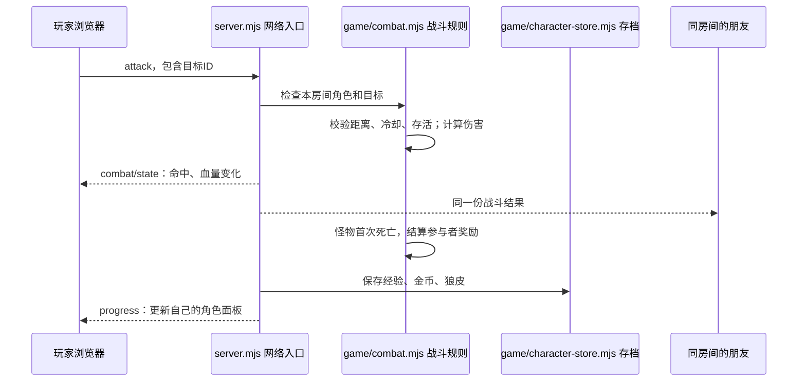

# 用这个项目学习游戏框架与资源逆向

学习目标是能解释、修改和验证整个链路。重复编码、资源转换和测试准备可以由助手完成，关键设计需要结合运行结果逐步理解。每一轮只追踪一个行为，不要求先读完整个项目。

## 先分清我们正在做的两类工作

**逆向资源格式**：读取现有 APK/下载包，观察文件头、指针、压缩和数据布局，提出格式解释并用 CRC、网格边界、法线等证据验证。入口是 `tools/resource_packs.py`、`bdae_convert.py`、`terrain_convert.py`。

**重新实现游戏框架**：编写自己的网络协议、游戏规则和存档层，让已转换的数据在浏览器中参与游戏。打怪、奖励、存档是本项目新写的逻辑，不代表找回原版游戏源码或原版战斗规则。

模型只提供形状与贴图。它能画在屏幕上，并不意味着它有血量、会攻击或会掉奖励；这些行为由服务端的游戏状态与规则赋予。

## 逆向第一课：原 APK 怎样找到外部资源

先读 [启动入口、资源目录与包内索引的实证](../analysis/APK资源加载分析.md#本课怎样找到线索再验证)。本课沿“Manifest 入口 → Java 启动 → 原生初始化 → 资源目录”寻找调用证据，再用一个原始模型验证“索引字段 → 包内偏移 → 解压 → CRC”。

三个证据等级要分清：字符串命中提供线索；指令与参数传递确认静态调用；运行日志才能确认某次实际执行。本地资源解析实验验证数据组织方式，不能代替原客户端实际加载路径。只读复现入口是 `tools/inspect_resource_entry.py`。

## 框架案例：一次攻击如何变成存档里的奖励

这里最重要的是**决定权**：浏览器表达“我要攻击这个目标”，服务器决定是否命中以及造成多少伤害。浏览器不能通过一条消息直接给自己增加金币。

## 代码职责地图

| 部分 | 入口 | 负责什么 |
|---|---|---|
| 画面与输入 | `prototype/public/client.js` / `explore.js` | 按键、点击、角色/怪物显示、血量与奖励反馈 |
| 浏览器恢复凭据 | `prototype/public/character-session.js` | 按角色名记录 ID 与恢复凭据，便于选择自己的角色 |
| 网络与会话 | `prototype/server.mjs` | 接收消息、加入房间、同步快照、处理断线 |
| 世界坐标与移动 | `prototype/public/world.js` | 场景尺寸、速度、障碍与移动计算 |
| 战斗规则 | `prototype/game/combat.mjs` | 攻击距离、冷却、血量、怪物行为、奖励结算 |
| 存档层 | `prototype/game/character-store.mjs` | 固定角色 ID、凭据校验、持久化进度 |
| 自动验证 | `prototype/test/` | 用真实网络连接验证公平性、同步和重启恢复 |

文件之间的边界比文件数量更重要：画面不负责计算奖励，存档不负责决定伤害，网络入口把两者连接起来。

## 三个设计问题

### 为什么不能用名字当存档身份？

名字是给人看的，可能重复或改变。固定角色 ID 是身份，服务器发放的随机凭据证明浏览器可以恢复这个 ID。服务器广播的公开角色数据中没有凭据。只知道朋友的名字，不应该就能拿走朋友的角色。

当前采用本地测试用的轻量身份机制，不是完整账号系统。浏览器凭据与服务器存档缺一不可。新浏览器、换网址或清理浏览器存储后，需要另行迁移凭据；复制邀请链接只传房间号。

### 为什么不能每个画面帧都写存档？

屏幕画面和网络位置会频繁变化，而磁盘写入属于另一种工作。服务端可以高频更新内存，定期保存移动，并在奖励、离开、正常关闭等关键时机保存进度。存档模块集中处理写文件失败和完整性，避免每个战斗函数都自己开文件。

### 为什么怪物倒下只能发一次奖励？

多个玩家可能几乎同时攻击。如果每条攻击消息都能“发现怪物死了就发奖励”，同一只怪物可能重复发奖。规则需要识别一次存活到死亡的转变，并清晰定义参与者奖励。

## 每次运行只观察一件事

1. **先观察网络**：按攻击键，在浏览器开发者工具的 Network → WS 中查看发送帧和返回帧。先找 `attack` 的目标 ID，再找血量快照及 `progress`。
2. **再观察规则**：在战斗模块中找到服务端的攻击伤害/冷却配置。修改后重启服务，验证双方看到的变化一致。
3. **最后观察存档**：打败一只怪，记下经验和金币。退出再进入、正常停止服务再启动，验证进度恢复。服务器存档在 `runtime/`，始终不提交 Git。

不要同时改多个规则；先预测会看到什么，再实际验证。若结果不同，沿“输入→网络→规则→存档→显示”逐段找证据。

## 后续练习顺序

完成这条链路后，再逐步加入不同怪物、技能、背包和任务。每次先明确服务器要保存哪些状态、客户端发送什么意图、其他玩家应看到什么，再写实现。最终目标是能够自己画出数据流，并知道一个功能该改哪一层。
